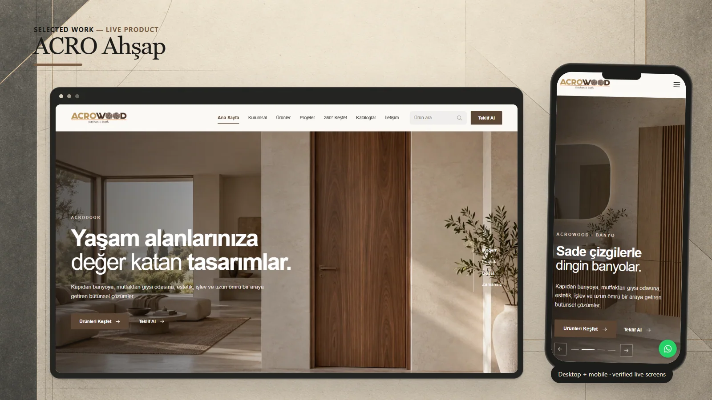
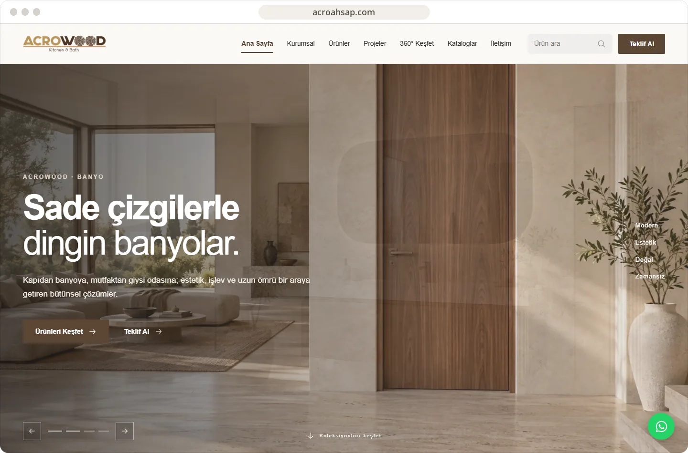
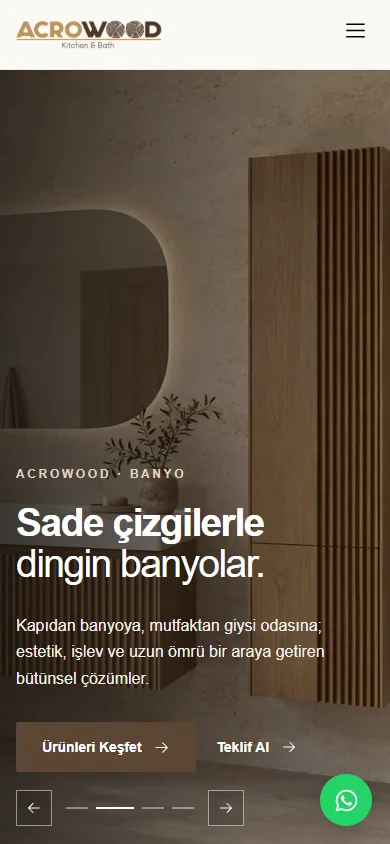

# ACRO Ahşap

A visual product catalogue for doors, kitchens, bathrooms, wardrobes, and interior living solutions.

**[Visit live website](https://acroahsap.com)**

## Highlights

- Product discovery across multiple living-space categories
- Project, catalogue, and 360-degree exploration sections
- Search and quotation entry points
- Image-led responsive presentation

## Verified technology

Next.js, React, TypeScript, and Supabase integration are confirmed through the live output and the corresponding local source structure.

## Live interface

 

## About this repository

This presentation-only repository contains selected public screenshots, this README, and a small static introduction page. Application source and private configuration are not published here.

Visual content and brand assets remain the property of their respective owners. See [LICENSE](LICENSE).
