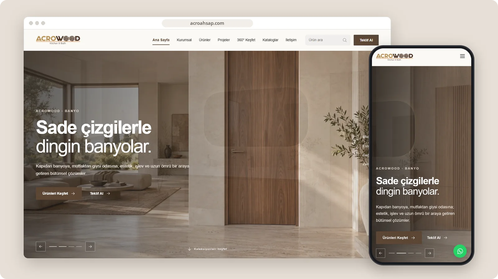

# Acro Ahşap

A visual product catalogue for doors, kitchens, bathrooms, wardrobes and interior living solutions.

**[Visit acroahsap.com ↗︎](https://acroahsap.com)** &nbsp;·&nbsp; [More work by Mert Ömeroğlu](https://github.com/mertomeroglu)

### Highlights

- Product discovery across multiple living-space categories
- Project, catalogue and 360-degree exploration sections
- Search and quotation entry points
- Image-led responsive presentation

### Built with

Next.js · React · TypeScript · Supabase

### Screens

---

Presentation-only repository. Images are real, unmodified product screens in a simple frame; application source and private configuration are not published here. Brands and visual content belong to their respective owners — see [LICENSE](LICENSE).
