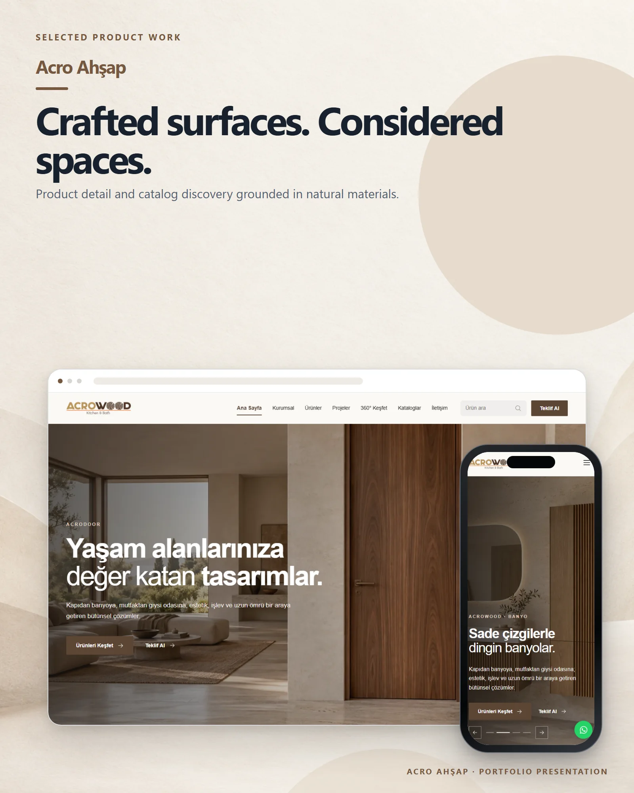

# Acro Ahşap

A visual product catalogue for doors, kitchens, bathrooms, wardrobes and interior living solutions.

**Live:** [acroahsap.com](https://acroahsap.com) &nbsp;·&nbsp; **More work:** [github.com/mertomeroglu](https://github.com/mertomeroglu)

### Highlights

- Product discovery across multiple living-space categories
- Project, catalogue and 360-degree exploration sections
- Search and quotation entry points
- Image-led responsive presentation

### Built with

Next.js · React · TypeScript · Supabase

---

Presentation-only repository: this README and two presentation images built from real product screens. Application source and private configuration are not published here. Visual content and brand assets remain the property of their respective owners — see [LICENSE](LICENSE).
